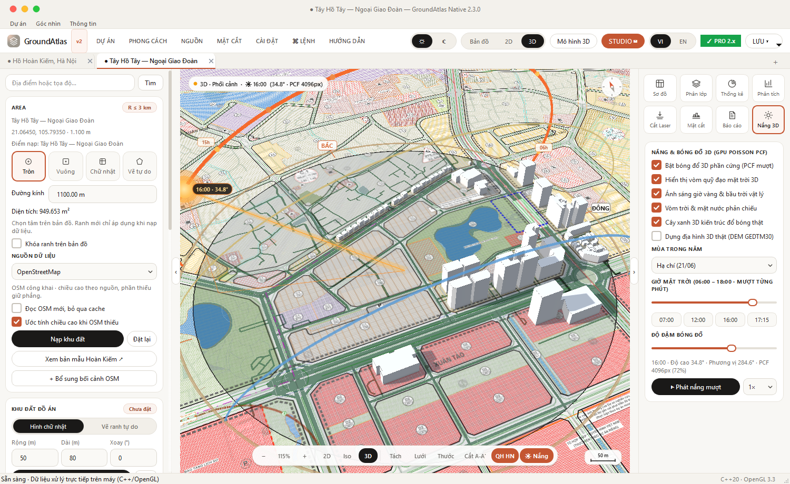
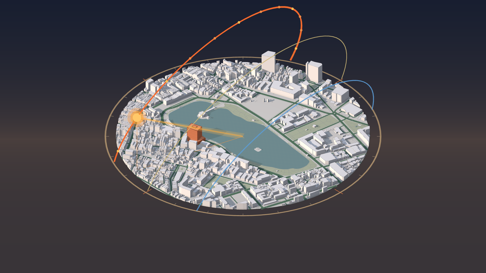

# GroundAtlas Desktop — Native C++20 Architectural Site Analysis Workstation

> **100% Pure Compiled Native C++20 / Qt 6.8 / OpenGL 3.3 / MapLibre Native (0% Electron · 0% WebView)**
> Nạp hiện trạng khu đất OpenStreetMap toàn cầu trong 2 giây, đè lớp quy hoạch 2D/3D, nhập trực tiếp SketchUp `.skp`, cắt mặt cắt A–A' sống và xuất trọn Bộ hồ sơ kiến trúc 8 tệp chỉ với 1 cú bấm.

  <a href="https://github.com/hienkhang2004-coder/GroundAtlas/raw/main/GroundAtlas-Desktop-2.3.1-Setup.exe">
    <strong>⬇ Tải bản cài Windows x64 miễn phí (v2.3.1 · 20 MB)</strong>
  </a>
  &nbsp;&nbsp;·&nbsp;&nbsp;
  <a href="https://groundatlas-license-server.groundatlas.workers.dev/">
    <strong>⚡ Mua bản quyền Pro Trọn đời 2.x (Early Bird 99.000đ)</strong>
  </a>
  &nbsp;&nbsp;·&nbsp;&nbsp;
  <a href="https://groundatlas.groundatlas.workers.dev/">
    <strong>🌐 Phiên bản Web</strong>
  </a>

---

## Hình ảnh thực tế trên GPU

| Đồ họa 3D Kiến trúc & 69 Sơ đồ | Mặt cắt A–A' trực tiếp (Dark Studio) |
|---|---|
|  |  |

---

## Tính năng nổi bật (Độc quyền bản Desktop Native)

- **Thuần mã máy C++20 / OpenGL 3.3 (180–500 Hz):** khởi động tức thì, chạy trực tiếp trên GPU Windows, đổ bóng mềm Poisson PCF **4096px** và bầu trời vật lý giờ vàng mượt từng phút.
- **Nạp khu đất OpenStreetMap toàn cầu siêu tốc (~2 giây):** tích hợp OSM REST API v0.6 + tự chia lưới 2×2 cho khu vực dày đặc + 4 máy chủ Overpass dự phòng.
- **Đè lớp Quy hoạch sử dụng đất 1-Click (2D & 3D):** hỗ trợ bật/tắt nhanh lớp quy hoạch Hà Nội (`qhpk`, `khsdd`, `qhct`) hoặc dán **Custom XYZ Tile URL** hợp pháp riêng, phủ trực tiếp lên Bản đồ, 2D và phối cảnh 3D có bóng đổ thật.
- **Nhập trực tiếp mô hình 3D SketchUp (`.skp`):** kéo thả thẳng file `.skp`, `.dae`, `.obj`, `.glb`, `.stl` vào hiện trạng khu đất thật.
- **Cắt mặt cắt A–A' sống & Concept Massing 3D:** kéo mặt cắt trực tiếp trên viewport 3D, dựng khối phương án tự tính diện tích sàn, mật độ xây dựng (BCR) & hệ số sử dụng đất (FAR).
- **Xuất Bộ hồ sơ 8 tệp chỉ 1 cú bấm:** CAD `.DXF` 3D, SketchUp `.DAE`, ảnh 4K PNG & 8K Alpha PNG (Photoshop), Báo cáo PDF A3, GIF Timelapse nắng 3D, Laser Cut & Mặt cắt `.SVG/.DXF`.
- **Tự động báo cập nhật ngay trong app:** miễn phí mọi bản vá lỗi & tính năng mới dòng `2.x`; cài đè tự động giữ nguyên bản quyền Pro đã kích hoạt trên máy.

---

## So sánh Bản Free vs Bản Pro (Mua đứt 1 lần · Trọn đời 2.x)

| Tính năng | Bản Free (0đ · Vĩnh viễn) | Bản Pro Trọn đời 2.x (1 Seat = 1 Máy) |
|---|:---:|:---:|
| Xem bản đồ toàn cầu & Nạp khu đất OSM mọi vị trí | ✅ Không giới hạn | ✅ Không giới hạn |
| Khung nhìn 2D / 3D / Tách tầng / Xoay nắng 180Hz / 69 sơ đồ | ✅ Full | ✅ Full |
| Bật/tắt lớp Quy hoạch (2D & 3D) + Xem mặt cắt live | ✅ Full | ✅ Full |
| Xuất CAD `.DXF` 3D, SketchUp `.DAE`, `.GLB`/`.STL`, Laser Cut | 🔒 | ✅ Không giới hạn |
| Xuất ảnh 4K / 8K Alpha PNG, Báo cáo PDF A3, GIF, **Bộ 8 tệp 1-click** | 🔒 | ✅ Không giới hạn |
| Nhập trực tiếp `.skp` / 3D & Dựng khối Massing FAR/BCR | 🔒 | ✅ Không giới hạn |
| Chạy Offline 14 ngày · Tự chuyển máy (2 lần / 6 tháng) | — | ✅ Có sẵn |

- **Đợt 1 · Early Bird (100 suất đầu):** Cá nhân `1 Seat` chỉ **99.000đ** · Nhóm `3 Seats` **249.000đ** · Studio `5 Seats` **399.000đ** · Công ty `10 Seats` **690.000đ**.
- Thanh toán **VietQR** đối soát tự động — nhận mã bản quyền `GA2X-XXXX-XXXX-XXXX` ngay sau 5 giây tại [trang bản quyền chính thức](https://groundatlas-license-server.groundatlas.workers.dev/).

---

## Yêu cầu hệ thống & Cài đặt

- **Hệ điều hành:** Windows 10 / 11 (64-bit), card đồ họa hỗ trợ OpenGL 3.3 trở lên.
- **Cài đặt:** Tải [`GroundAtlas-Desktop-2.3.1-Setup.exe`](https://github.com/hienkhang2004-coder/GroundAtlas/raw/main/GroundAtlas-Desktop-2.3.1-Setup.exe) (20 MB) và mở chạy trực tiếp — không cần quyền Admin, không cần cài thêm thư viện ngoài.

## Giấy phép nguồn mở & Dữ liệu

Chi tiết giấy phép các thư viện nguồn mở được sử dụng (Qt 6.8 LGPLv3 liên kết động, MapLibre Native BSD-2, Monocypher CC0/BSD-2, Earcut ISC, OpenStreetMap ODbL 1.0) xem tại tệp [`LICENSES.txt`](LICENSES.txt).
